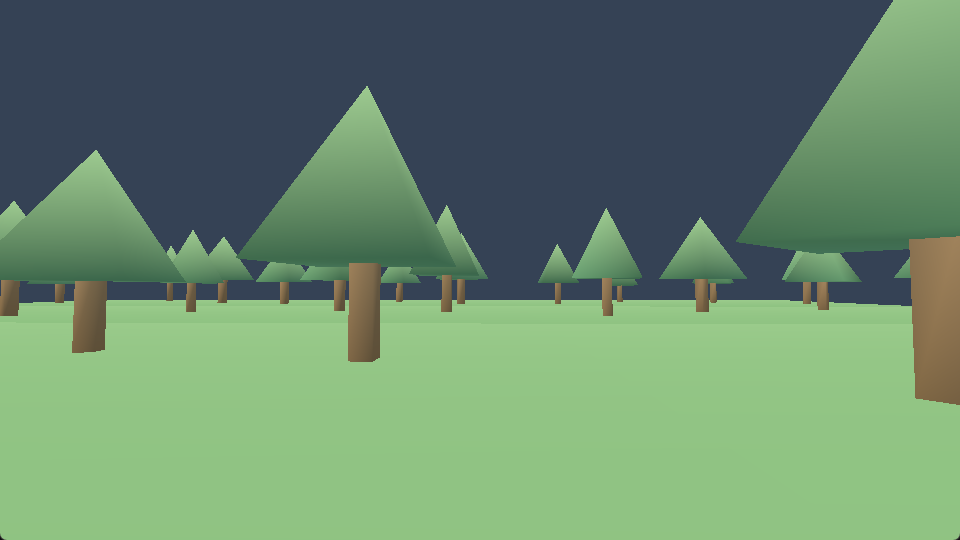

<p align="center">
  <picture>
    <source media="(prefers-color-scheme: dark)" srcset="docs/images/logo-dark.svg">
    
  </picture>
</p>

<h1 align="center">laiue</h1>

<p align="center">
  Modular engine in C17 for any application.<br>
  Take only the modules you need.
</p>

<p align="center">
  <a href="https://github.com/landiunload/laiue/actions/workflows/build.yml"></a>
  <a href="https://github.com/landiunload/laiue/releases/latest"></a>
  <a href="LICENSE"></a>
  
</p>



laiue is a set of libraries your application links, not a framework that runs
it. Each technology is a separate module behind a C ABI: remove one, and the
rest keep working. Application logic, world generation and networking stay in
your code.

## Features

- **Worlds** — infinite coordinates with origin rebasing; sparse voxel and mesh
  worlds with streaming, meshing and raycasts.
- **Physics** — deterministic character collision and rigid bodies.
- **Graphics** — D3D12 and Vulkan, in a window or offscreen, with an
  immediate-mode UI.
- **Animation and audio** — skinning, a mixer, WAV and MP3 streaming.
- **Content** — model, texture, sound and shader packs with built-in decoders.
- **Mods** — native extensions through a versioned C ABI.
- **Lean** — no CRT on Windows, portable core on x86_64 and ARM64.

## Getting started

Prebuilt SDKs for Windows, Linux and macOS are on the
[releases page](https://github.com/landiunload/laiue/releases/latest).

To build from source you need CMake 4.2+ and Ninja. On Windows, use a Visual
Studio Developer PowerShell:

```powershell
cmake --preset windows-msvc
cmake --build --preset windows-msvc-release --parallel
ctest --preset windows-msvc-release --parallel
```

On Linux:

```sh
cmake --preset linux-gcc
cmake --build --preset linux-gcc-release --parallel
ctest --preset linux-gcc-release --parallel
```

Add `-DLAIUE_BUILD_EXAMPLES=ON` to build the examples:
[walk](examples/walk/README.md) on a voxel world,
[mesh_world](examples/mesh_world/README.md) and
[animation](examples/animation/README.md).

## Usage

```cmake
find_package(laiue CONFIG REQUIRED)
target_link_libraries(game PRIVATE laiue::engine)
```

```c
#include "numeric/numeric_service.h"
#include "world/numeric_provider.h"
#include "world/world.h"

int main(void)
{
    WorldSetNumericService(LaiueNumericGetStaticServiceV1());

    World* world = WorldCreate(NULL); // empty world: air everywhere
    WorldTrySetBlock(world, 0, 0, 0, 1); // block types 1-255 are yours
    BlockType block = WorldGetBlock(world, 0, 0, 0);
    WorldDestroy(world);

    return block == 1 ? 0 : 1;
}
```

## Platforms

| Platform | Architectures | Graphics |
|---|---|---|
| Windows | x86_64, ARM64 | D3D12, Vulkan |
| Linux | x86_64, ARM64 | Vulkan on x86_64 |
| macOS | arm64, x86_64 | — |
| Android | arm64, x86_64 | Vulkan example |
| iOS | arm64 | — |

Every platform builds the core: world, physics, content and mods.
Details are in [portability](docs/portability.md).

## Documentation

[Architecture](docs/architecture.md) ·
[Physics](docs/physics.md) ·
[Content formats](docs/content_formats.md) ·
[Modding](docs/modding.md) ·
[Development](docs/development.md)

The documentation is written in Russian.

## License

[MIT](LICENSE)
